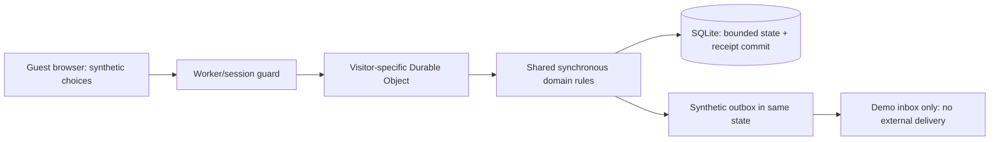

# My architecture choices and recovery runbook

**Ayo Ahmed — Independent concept for Trybe. Unofficial; synthetic only.**

I use one small domain state machine for a narrowly bounded package. My architectural goal is to make a complete reservation and its receipt one commit, and to make every retry or recovery inspect that same authoritative state. This is an independent contract; it is not API-compatible with Trybe.

## Current architecture and evidence boundary

The shared domain implementation is [src/domain.js](../src/domain.js). It takes persisted state plus an action, applies expiry and computes the requested changes on a clone. A valid action commits the complete result; a rejected action retains expiry already processed and a bounded audit entry, while discarding that action's attempted changes. The implemented server is a [Cloudflare Worker](../src/worker.js) routing a visitor session to a SQLite-backed Durable Object. Its SQL read, rule application and state/security write run inside `storage.transactionSync`. Implementation is distinct from execution evidence: [test results](test-results.md) identifies the runtimes and cases actually exercised. Local emulator success does not establish public HTTPS deployment or production behavior.

Each visitor receives isolated synthetic inventory. This protects demonstrations from interfering with one another and makes reload persistence reviewable. It intentionally does **not** prove contention between different real guests sharing a venue. The competing reservation lives inside the same synthetic session, and production would require a venue-scoped authoritative allocator with authenticated guest/operator access.

## Internal data model

| Entity | Key evidence and meaning |
| --- | --- |
| Resource | Composite `site|offeringType|id`; supported capacity and currency. Site/type identity prevents raw ID collisions. |
| Package option | Two parts, three claims, interval boundaries, GBP component prices and total in integer minor units. |
| Quote | Option ID, state revision, price revision, snapshot time and 60-second simulated expiry. It holds no capacity. |
| Booking | Copied parts/claims, held/submitted/terminal status, total/currency, booking revision, original 120-second deadline, consent and optional validation/exception. A separate order ID appears only on submission; payment status begins not-started, then pending, then a simulated outcome or void. |
| Validation | Current booking, state and price revisions; valid only until the hold deadline and invalidated by any edit. |
| Receipt | Bounded idempotency key, action fingerprint, booking ID, reserve/submit type and synthetic timestamp. |
| Settlement event | Event ID, action fingerprint, sequence, booking and synthetic outcome. Duplicate/conflicting IDs are distinguished. |
| Audit/outbox | Bounded diagnostic transition records and deduplicated synthetic handoffs. Neither is a real notification service. |
| Import preview | Strict synthetic resource rows, state revision, preview ID and 60-second expiry; commit is atomic. |

The seed uses a fixed clock of 2026-10-13 09:00 UTC and a fixed future package day. Prices use integer minor units; parsing refuses negative values and more than two decimal places instead of silently rounding. GBP is the only supported currency. Tax, currency conversion and cash rounding are outside scope.

## Transaction and API decisions

I expose actions through one domain boundary: read state, availability, reserve, edit, validate, submit, receipt lookup, settlement, fulfillment, release/void, import preview/commit and explicit simulation controls. The public UI must not send an authoritative total or arbitrary guest details. The server derives the selected option and validates every claim.

A reserve or submit key cannot be repurposed for different evidence. A successful retry returns the original receipt plus the current booking state. This is important: a replay of a once-successful reservation after expiry reports the expired current booking; it cannot revive the original hold. If a receipt is absent, the result remains unknown until state is inspected. Receipts are bounded per synthetic session and cleared by a deliberate scenario reset, so they do not promise indefinite financial idempotency.

Capacity checking is conservative: overlapping claims are summed across the requested interval. This prevents overselling within the tested slice but can reject some combinations that a more precise time-sliced allocator could admit. I prefer a safe false negative in this proof over pretending to implement a general scheduling engine. All claims and their receipt are persisted as one bounded JSON state row inside a SQLite transaction; this is easy to inspect but is unsuitable as an unbounded venue ledger or analytics store.

Expiry is evaluated on domain requests and explicit simulation clock advancement. The simulation has no live clock-based hold alarm. Submitted orders retain the original hold deadline; failure or timeout produces an exception and releases capacity. This is a demonstration policy, not a production payment authorization window.

## Bounds and abuse model

The domain caps state at 131,072 serialized characters, resources at 36, import rows at 12, bookings at 24, receipts at 48, settlement events at 64, quotes at 24 and rolling audit records at 80. The synthetic outbox caps twelve items per session and three unique handoffs per simulated minute, with repeated deliveries suppressed. A strict import rejects personal names/contact fields and arbitrary keys; accepting only predefined synthetic shapes reduces accidental data entry but is not a personal-data detector for arbitrary strings.

The implemented [request guard](../src/http.js) adds a UUID session cookie with HttpOnly/SameSite=Strict attributes and Secure on HTTPS, a separate 32-byte random session token, an exact-origin check for state-changing requests, a 16 KiB request-body cap, persisted limits of 240 requests per real minute and 2,000 per session, and a 24-hour real-time session expiry. I distinguish these server controls from the fixed simulation clock. Runtime evidence must identify which runtime exercised them.

| Threat or failure | Control within this concept | Remaining limitation |
| --- | --- | --- |
| Cross-origin state mutation | Exact-origin POST guard and session token. | No authenticated production guest/operator roles; same-origin compromise remains a risk. |
| Duplicate request or lost response | Reserve/submit idempotency receipt and lookup. | Bounded session retention; no live financial reconciliation. |
| Stale/edited evidence | Quote/state/price/booking revision checks and revalidation. | Correctness still depends on inventory being authoritative. |
| Oversell/partial reservation | Synchronous shared rules and whole-state SQLite commit. | Visitor isolation cannot model contention across real guests or upstream systems. |
| Malformed/personal import | Strict synthetic keys, row bounds, preview and atomic commit. | No real data import pipeline or data classification guarantee. |
| Unbounded request/state growth | Body, request, session and collection caps. | A visitor can start new sessions; no durable identity, global abuse quota or production cost budget is implemented. |
| Duplicate/out-of-order settlement | Event fingerprints, sequence and terminal-state monotonicity. | No signed provider events, refund workflow or real money reconciliation. |
| External delivery side effects | Synthetic-only deduplicated outbox. | No production delivery, retry, dead-letter or exactly-once promise. |

These controls make a bounded synthetic review safer; they do not constitute a production security certification. HTTPS, secure-cookie behavior, platform isolation, operational monitoring and shared venue allocation need target-runtime verification before a live pilot.

## Recovery runbook

I would use the reference and current state before taking any recovery action. I would never resolve an unknown payment result by issuing a second order blindly.

| Situation | My first check | Safe action in the proof | Production work still needed |
| --- | --- | --- | --- |
| Guest says reserve/submit hung | Original idempotency key and receipt/current booking. | Lookup receipt; if found, resume that booking. If not found, refresh authoritative state before retrying. | Retained receipt ledger, support search and provider reconciliation. |
| Stale quote or final-capacity conflict | Latest availability and current booking ownership. | Refresh and show explicit alternatives. | Feed freshness monitoring and shared allocator checks. |
| Hold expiry | Current simulated clock and status. | Confirm expired resources released; request fresh availability. | Real timers/alarms, grace policy and monitoring. |
| Price/time change | Current authoritative option and validation. | Release held package; refresh; require deliberate new selection. | Venue pricing policy and approval rules. |
| Failed/timed-out settlement | Exception reason, current state and ownership. | Demo operations lead records synthetic handoff, safely voids and offers a fresh package. | Provider-ledger reconciliation; decide refund/late-success handling before rebuy. |
| Fulfillment attempted while submitted | Settlement state and event history. | Block fulfillment; wait for valid simulated settlement. | Signed payment confirmation and role permission. |
| Unsafe settled-order void | Settled/fulfilled state. | Reject void and preserve record. | Real cancellation/refund policy and audit trail. |
| Import fails or becomes stale | Preview reason, revision and expiry. | Fix synthetic rows; preview again; commit only valid current preview. | Production import authorisation, schema governance and staging checks. |
| Session/state limit reached | Limit code and retained references. | Start a fresh synthetic demonstration only after recording needed evidence. | Retention, archival and global capacity/cost policies. |

For a pilot I would pause new attempts on any confirmed integrity breach, preserve order/receipt/event references, identify affected allocations, reconcile with the payment and inventory authorities, and have the named operational owner approve resumption. A scenario reset is a demo convenience, not production rollback. No recovery step in this concept contacts anyone or moves money.
