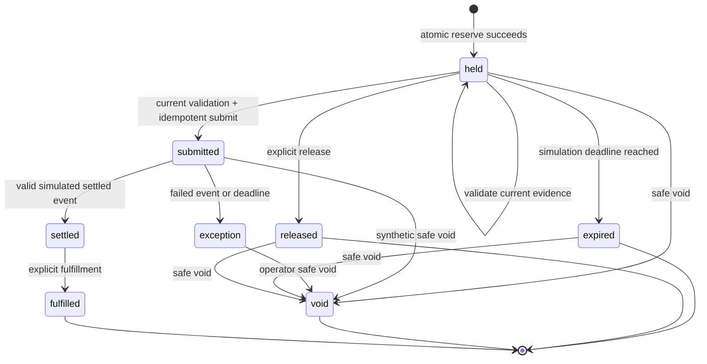

# My guest and operator journey

**Ayo Ahmed — Independent concept for Trybe. Unofficial; all records and payments are synthetic.**

I design the happy path and the recovery path as one workflow. The state shown to the guest must be the state the server can support. These are intended interactions backed by the current domain rules; visual/runtime observations are recorded separately in [test results](test-results.md).

## Guest journey

| Moment | Guest question | System evidence | Next action or recovery |
| --- | --- | --- | --- |
| Explore | “Can I do the whole visit?” | Two package parts, practitioner/room/shared-area requirements, explicit times and authoritative total. Availability snapshot holds nothing. | Request fresh availability and choose an option. |
| Reserve | “Are these components mine temporarily?” | Atomic reserve returns one booking and receipt. Hold lasts 120 simulated seconds. | Complete synthetic guest/consent selection; if conflict, refresh and explicitly choose the later/differently priced option. |
| Edit | “What details am I committing?” | Only the predefined synthetic guest and bounded preference are accepted. Every edit invalidates validation. | Validate the edited selection again. |
| Validate | “Does this exact package still work?” | Server checks active hold, component capacity, latest time/price, guest consent and revisions. | Submit only after current evidence passes. Changed time/price requires release, refresh and deliberate selection. |
| Submit | “Has payment finished?” | Idempotent submission creates a submitted order and receipt. Payment has not settled. | Wait for/simulate settlement; fulfillment remains blocked. If the response is lost, recover the original receipt. |
| Settle | “Is the complete booking ready?” | A valid synthetic settlement event marks settled. A separate fulfillment action is then permitted. | Fulfill once, or inspect a failed-settlement exception owned by Demo operations lead. |
| Recover | “Do I need to start again?” | Expired/released/exception/void states no longer claim inventory. Receipt recovery identifies an already committed request. | Refresh availability when capacity is released; use a new attempt/key only after resolving the original result. |

I do not silently replace the guest's first choice with the later £120 package. The standard package is £110, with its treatment at 14:00 and shared session at 15:15 in the fixed synthetic day. The later option has its treatment at 16:00 and shared session at 17:15. These fixture times are UTC, not an inferred venue timezone. Both the time difference and the price difference require a visible choice.

## Operator journey

An operator checks the submitted order's state and reference before acting. A failed settlement or submission deadline creates an exception whose owner is **Demo operations lead**. The synthetic handoff records the booking reference, current state and next step in a local outbox. No email, SMS or webhook is sent.

The operator can safely void an eligible held, submitted, expired, released or exception record. The rules reject voiding settled or fulfilled records because this concept has no real refund policy. A submitted order is not a paid order: the operator must wait for settlement before fulfillment. Repeated fulfillment and duplicate/out-of-order settlement events cannot create a second fulfillment.

## Domain state diagram

The diagram describes booking states. “Validated” is a revision-bound property of a held booking, not a separate durable booking status.

Duplicate requests are replay/recovery operations, not new transitions. Duplicate settlement IDs with the same evidence are suppressed; reused IDs with different evidence conflict. Old event sequences and events arriving after a terminal booking state are ignored. A late success after a failed/expired/void order cannot reopen capacity ownership in this proof. A production integration would need to reconcile the associated real money separately.

## Recovery decisions I want visible

| Failure | What must remain true | Available next step |
| --- | --- | --- |
| Stale or expired quote | No partial reservation exists. | Refresh availability and choose again. |
| Final capacity taken | Competing booking keeps its valid claim; losing guest owns none. | Explicitly inspect the alternative or leave the flow. |
| Hold expired | All package capacity is released. | Refresh; never revive the old validation. |
| Price/time changed | Guest does not inherit a silent substitute. | Release, refresh and accept the updated package. |
| Edited after validation | Submission cannot use old evidence. | Validate again. |
| Lost reserve/submit response | Retry cannot create another booking/order for the same key. | Look up the original receipt; inspect current state before retrying. |
| Failed settlement | No fulfillment; exception owner is explicit; capacity released. | Record synthetic handoff, safely void and offer fresh availability. |
| Unsafe void request | Settled/fulfilled commitment remains intact. | Escalate to a real refund/reconciliation policy outside the proof. |

## Accessibility and trust checks

I expect recovery actions to remain reachable by keyboard, focused sensibly after errors, labelled with the consequence and usable at 320, 390, 540 pixels and desktop width. I expect stale evidence and exception ownership to be expressed in text, not colour alone. The unofficial/synthetic disclosure must stay visible throughout. These are acceptance expectations; I make completion claims only for the views and tasks actually inspected.
